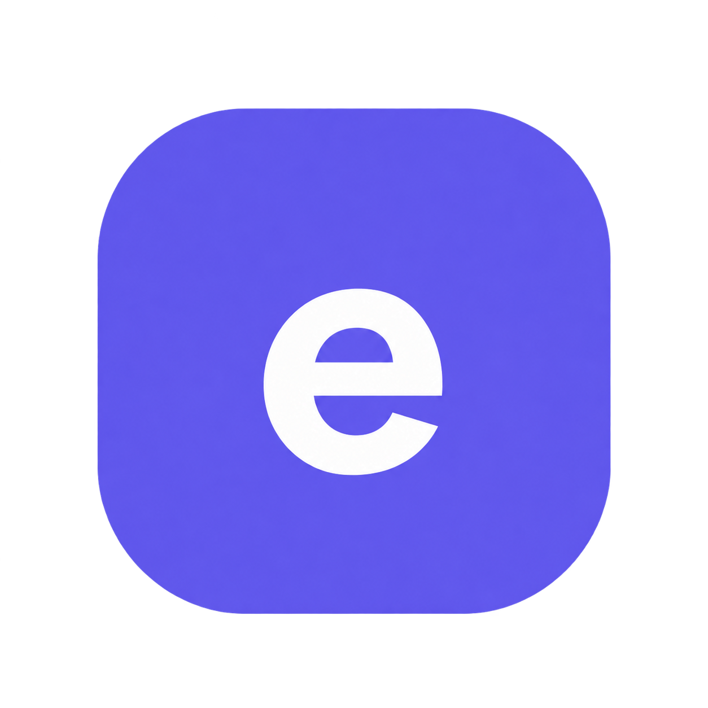

<div align="center">
  
  <h1>EduSphereX</h1>
  <p><strong>Learn with purpose. Grow with confidence.</strong></p>
  <p>A modern, responsive education website concept built with HTML, CSS, and vanilla JavaScript.</p>
  <p>
    
    
    
    
    
  </p>
</div>

---

## Overview

**EduSphereX** is a polished multi-page frontend for an online learning platform. It gives learners a place to discover courses, explore learning categories, read articles, learn about the platform, and navigate common account and support pages.

The interface uses a purple-led visual identity, responsive layouts, a light/dark theme, interactive course discovery, and small usability details throughout. It is built as a static website, so there is no framework setup, package installation, or compilation step.

## Contents

- [Highlights](#highlights)
- [Pages](#pages)
- [Tech stack](#tech-stack)
- [Run locally](#run-locally)
- [Project structure](#project-structure)
- [Customization](#customization)
- [Deployment](#deployment)
- [Current scope and limitations](#current-scope-and-limitations)
- [License and assets](#license-and-assets)

## Highlights

- **Clean, responsive interface** designed for desktop, tablet, and mobile layouts.
- **Light and dark themes** with the selected preference saved in browser local storage.
- **Course discovery** with search and category filtering on the course listing interface.
- **Mobile navigation** with an accessible expanded/collapsed state.
- **Interactive FAQs** with expandable answers.
- **Client-side form checks** and visible demo feedback for login, registration, contact, and newsletter forms.
- **Consistent branding** with the EduSphereX `e` favicon and reusable visual styles.
- **Self-contained frontend** using local CSS, JavaScript, images, and Gilroy font assets.

## Pages

| Page | File | Purpose |
| --- | --- | --- |
| Home | `index.html` | Landing page, featured categories, popular courses, and calls to action |
| Courses | `assets/html/courses.html` | Course browsing and discovery |
| Categories | `assets/html/categories.html` | Browse learning topics |
| About | `assets/html/about.html` | Platform introduction |
| Learning journal | `assets/html/blog.html` | Articles and learning content |
| Contact | `assets/html/contact.html` | Contact form interface |
| FAQs | `assets/html/faq.html` | Common questions and expandable answers |
| Sign in | `assets/html/login.html` | Demo login interface |
| Create account | `assets/html/register.html` | Demo registration interface |
| Privacy policy | `assets/html/privacy.html` | Privacy information placeholder |
| Terms of use | `assets/html/terms.html` | Terms information placeholder |
| Refund policy | `assets/html/refund.html` | Refund information placeholder |
| Disclaimer | `assets/html/disclaimer.html` | Disclaimer information placeholder |

## Tech stack

- **HTML5** for page structure and content
- **CSS3** for layout, responsive behavior, styling, and themes
- **Vanilla JavaScript** for navigation, theme state, course filtering, FAQ interactions, and demo form behavior
- **Local assets** for imagery, SVGs, and typography

No npm packages or external JavaScript frameworks are required.

## Run locally

### Option 1: Open the page directly

1. Download or clone this repository.
2. Open the project folder.
3. Open `index.html` in a modern browser.

### Option 2: Use a local static server (recommended)

A local server gives you a more production-like browsing experience. From the project root, run:

```bash
python -m http.server 8000
```

On some Windows installations, use:

```powershell
py -m http.server 8000
```

Then open **http://localhost:8000** in your browser. You can also use the Live Server extension in Visual Studio Code.

## Project structure

```text
EduSphereX/
├── index.html                 # Homepage
├── favicon.png                # EduSphereX brand icon
├── favicon.ico                # Browser icon fallback
├── README.md
├── LICENSE
├── .gitignore
└── assets/
    ├── css/                   # Shared and page-specific styles
    ├── font/                  # Local font styles and Gilroy files
    ├── html/                  # Remaining static pages
    ├── images/                # Course, blog, category, and UI imagery
    └── js/
        ├── modern.js          # Theme, navigation, filters, FAQ, and demo forms
        └── script.js          # Existing site interactions
```

## Customization

- **Visual system:** Start with `assets/css/modern.css` for the refreshed theme, shared components, responsive rules, and dark mode.
- **Page-specific styling:** Edit the related stylesheet in `assets/css/` when a page needs unique presentation.
- **Page content:** Update `index.html` and the relevant file inside `assets/html/`.
- **Interactions:** Review `assets/js/modern.js`. Theme preference is stored under the `eduspherex-theme` local-storage key.
- **Branding:** Replace `favicon.png` and `favicon.ico` together if you change the logo. Keep the icon links in all HTML pages pointed at the correct relative paths.
- **Images and fonts:** Assets are stored under `assets/images/` and `assets/font/`.

## Deployment

EduSphereX is a static website and can be hosted on GitHub Pages, Netlify, Vercel, or another static web host.

For GitHub Pages:

1. Push the **contents of this project folder** to the repository so `index.html` is at the repository root.
2. Open the repository's **Settings → Pages**.
3. Select deployment from the `main` branch and the root (`/`) folder, then save.
4. Wait for the deployment status and open the published URL.

No build command or environment variables are needed for the current frontend-only version.

## Current scope and limitations

EduSphereX is currently a **frontend demonstration**, not a production learning management system.

- Login and registration do not create accounts or authenticate users.
- Contact and newsletter forms only show browser-side demo feedback; they do not send or store submissions on a server.
- Course enrollment and payment processing are not implemented.
- Course prices, platform statistics, testimonials, and some policy content are illustrative. Review and replace them before public or commercial use.
- Do not collect real user or payment information through the demo forms. A production release needs a secure backend, server-side validation, suitable privacy disclosures, and a tested enrollment workflow.

## License and assets

The project code is released under the [MIT License](LICENSE). Bundled imagery, fonts, icons, and other third-party assets may have separate ownership or license terms; verify their permissions before redistributing them or using the website commercially.

---

<div align="center">
  <sub>Built for curious minds. Keep learning, keep building.</sub>
</div>
